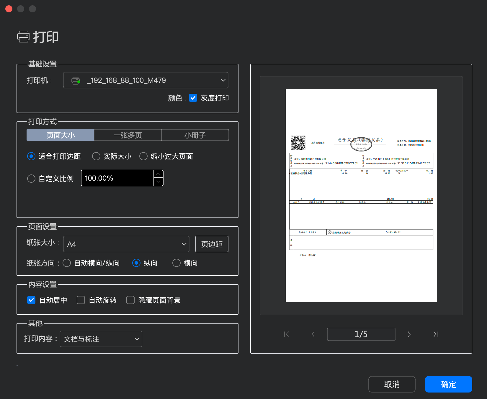
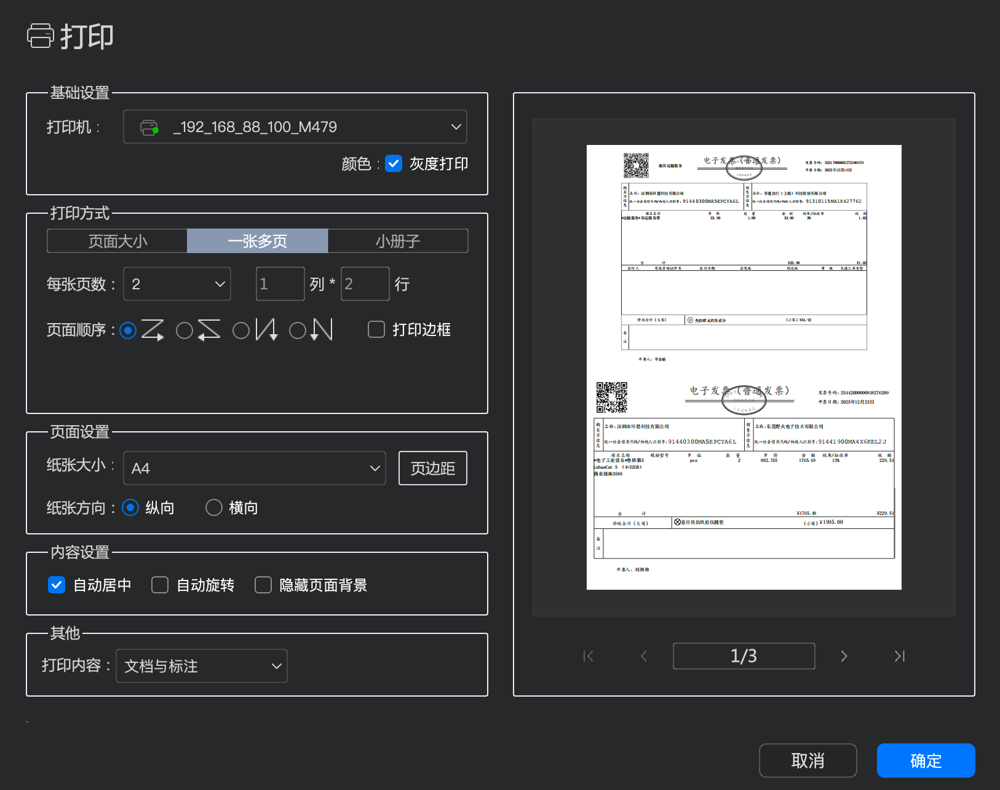

# 发票信息统计
## 统计要求：
### v1.0 按模板整理发票信息
1. 按《IDEA项目材料台账.xlsx》“材料费” 中的表头要求，将“材料费” 目录中的所有发票（pdf格式文件）信息依次提取出来保存到 对应的子表中；主要提取购买日期（开票日期）、发票号（发票号码）、物品名称（项目名称）、金额（提取价税合计中的小写发票金额，即含税价格）
2. 按《IDEA项目材料台账.xlsx》“差旅费”子表中的表头要求，依次提取“差旅费”目录中的发票信息，保存到对应的子表中；主要提取日期（开票日期）、发票号（发票号码）、发票名称（项目名称）、发票金额（提取价税合计中的小写发票金额，即含税价格）；
3. 提取出来后，按开票日期（即材料费中的购买日期，差旅费中的日期）正序排列；
4. 《IDEA项目材料台账.xlsx》表头中没有的字段保留空白即可；
5. 保留下所有统计工具代码，放在当前目录中，写好 readme, 并生成一启动安装依赖与启动脚本，供我以后使用
6. 帮我生成一套在 window 系统上可以使用的安装依赖与启动脚本

### v1.1 带有操作界面的发票整理工具
1. 利用 PyQt5 生成功能操作界面，主要布局为第一行为工具栏，下面为工作区，最下面有状态栏；
2. 工具栏上依次为以下功能按钮：
> 选择模板：点击后选择 xlsx 模板文件，即导入《IDEA项目材料台账.xlsx》；
> 选择发票：点击后选择发票所在目录，目录如果有子目录，如“材料费” 、“差旅费”目录，对应模板文件中的子表：材料费” 、“差旅费”; 如果没有子目录，将该目录中的所有发票分析统计到当前模板文件的选择的子表中；
> 统计： 点击统计后以上《v1.0 按模板整理发票信息》1-4的要求分析提取发票信息；分析过程中需要展示进度条，进度条上有取消按钮，其他按钮不可操作；提取后显示到工作区中；
> 导出： 点击导出后，将当前 工作区的 excle 内容以及子表内空导出为 xlsx 文件，文件名为模板文件名+当前时间，如“IDEA项目材料台账_20261029_1127.xlsx”;
> 退出：点击退出当前程序；
3. 工具栏下面为类似 excle 工作区的界面，展示导入的《IDEA项目材料台账.xlsx》的文件，以及后续分析完发票以后展示统计后的所有发票数据；
4. 状态栏中显示一些操作后反馈信息，或出错后的提示信息；状态栏在“统计”后目前显示：统计完成：共X张发票，增加合计金额，即显示为：统计完成：共X张发票，总金额为：xxxx.xx
5. 写好 readme, 并生成一启动安装依赖与启动脚本，包含 window 系统上使用的版本；
6. 发现一个问题：当通过选择子表统计发票信息时，统计完成后，当前子表数据导入了，但是其他子表中的数据没有了，期望当前目前没有子目录的情况下，只处理当前选择的子表，不要影响其他的子表内容；
7. 生成编译脚本 build.sh，可一键编译为 window 与 /macos 系统中可直接使用的 可执行程序,将程序编译到 当前目录的 bin 目录中，并且在 readme 写好说明

### v1.1.2 发票合并打印功能
1. 在统计按钮后面增加一个新按钮：“合并”，该按钮的功能为：将选择的所有发票合并为一个pdf文件的功能；点击合并后，需要展示进度条，进度条上有取消按钮，其他按钮不可操作；合并完成后显示“保存文件选择目录”的弹窗，提示用户将合并后的PDF文件保存到哪个目录下，文件名为“合并发票_日期_时间.pdf", 如：“合并发票_20261030_1642.pdf"；
2. 点击合并后，在“工作区”显示合并后的 pdf 文档；
3. 在退出按钮前增加“打印”按钮，点击后弹出设置窗口，如图所示两个设置界面，以标签页区分：、；点击确定后直接按照设置的打印方式打印发票；

4. 目前的打印功能只对合并的后的PDF文件有效，期望也可以打印导入的“IDEA项目材料台账.xlsx",以及统计后带有发票信息的“IDEA项目材料台账.xlsx”；
5. 目前“导出”功能只对“IDEA项目材料台账.xlsx"有效，期望也可以导出“合并后的PDF发票”：当前工作区如果展示的是“合并后的发票”，则导出合并后的发票，文件名格式依旧为：“合并发票_日期_时间.pdf"；当前工作区如果展示的是“IDEA项目材料台账.xlsx"，则导出的是 excle 文档，文件名格式依旧为：“IDEA项目材料台账_日期_时间.xlsx”；
6. 有了以上的导出功能，原功能：合并完成后显示“保存文件选择目录”的弹窗功能就不需要了；
7. 在文件标签上增加“x”关闭按钮，如在“合并发票预览”标签上增加“x”关闭按钮，可以由用户手动关闭相应的工作区展示内容；
8. 在“退出”按钮之前增加“帮助”按钮，点击后在工作区显示该软件的功能说明，以及操作说明；并且在帮助文件增加软件版本的说明，版本要求主要是用户可以免费使用，但是用于商业用途需要付费；

9. 合并发票为PDF文件的功能，期望合并后的发票先后顺序也要按照发票日期从小到大进行排列，即开票日期远的在前，开票日期近的在后；

10. 应用  作为当前发票信息统计小工具的应用图标；